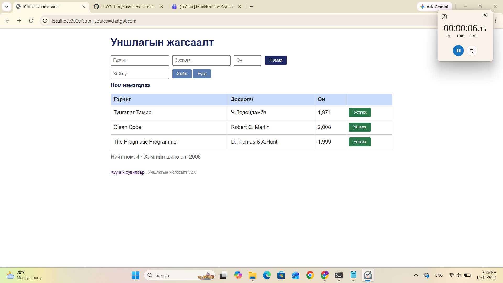

# BUG-01: Номын нийт тоо хүснэгтийн мөрийн тоотой зөрж байна

**Орчин:** Уншлагын жагсаалт v2.0, Windows 11, Google Chrome, 2026-10-19

**Ноцтой байдал:** Minor — Номын нийт тоог буруу харуулж, хэрэглэгчийг төөрөгдүүлж байна.

**Олдсон аялал:** Exploratory testing — анхны төлөв болон мэдээллийн харагдацыг шалгах.

## Урьдчилсан нөхцөл

`node app.js` командыг ашиглан серверийг шинээр эхлүүлсэн байх. Апп анхны 3 номтой байна.

## Дахин гаргах алхам

1. PowerShell дээр `node app.js` командыг ажиллуулна.
2. Хөтөч дээр `http://localhost:3000` хаягийг нээнэ.
3. Хүснэгтэд харагдаж буй номын мөрүүдийг тоолно.
4. Хүснэгтийн доорх **Нийт ном** гэсэн тоог шалгана.

## Хүлээгдэж байсан үр дүн

Анхны 3 ном хүснэгтэд харагдаж байгаа тул нийт номын тоо `3` байх ёстой.

## Бодит үр дүн

Хүснэгтэд 3 ном харагдаж байсан боловч **Нийт ном: 4** гэж харуулсан.

## Нотлох баримт

## Нэмэлт тэмдэглэл

Тестийн эхний `00:06` минутад уг зөрүүг ажигласан. Сессийн явцад ном устгах үед нийт тоо 1-ээр буурч байсан боловч анхны тооны зөрүү ажиглагдсан.