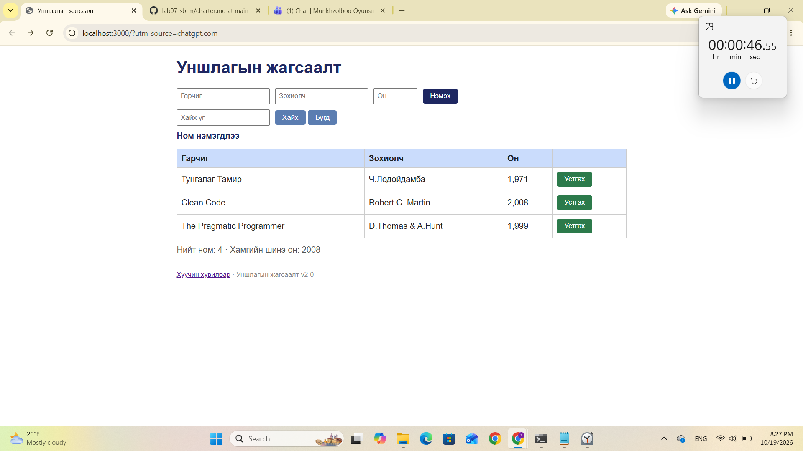

# BUG-02: Ном устгах товч ногоон өнгөтэй байна

**Орчин:** Уншлагын жагсаалт v2.0, Windows 11, Google Chrome, 2026-10-19

**Ноцтой байдал:** Cosmetic — Үйлдэл хэвийн ажиллаж байгаа боловч интерфейсийн өнгө шаардлагад нийцэхгүй байна.

**Олдсон аялал:** Supermodel Tour — хэрэглэгчийн интерфейсийн харагдах байдлыг шалгах.

## Урьдчилсан нөхцөл

`node app.js` командыг ашиглан серверийг шинээр эхлүүлсэн байх. Апп анхны 3 номтой байна.

## Дахин гаргах алхам

1. PowerShell дээр `node app.js` командыг ажиллуулна.
2. Хөтөч дээр `http://localhost:3000` хаягийг нээнэ.
3. Ном бүрийн хажууд байрлах **Устгах** товчны өнгийг ажиглана.

## Хүлээгдэж байсан үр дүн

Шаардлагын дагуу **Устгах** товчнууд улаан өнгөтэй байх ёстой.

## Бодит үр дүн

Бүх **Устгах** товч ногоон өнгөтэй харагдсан.

## Нотлох баримт

## Нэмэлт тэмдэглэл

Сессийн `00:46` хугацаанд илрүүлсэн. Энэ нь ном устгах үйлдлийн ажиллагаанд биш, интерфейсийн загвартай холбоотой согог юм.