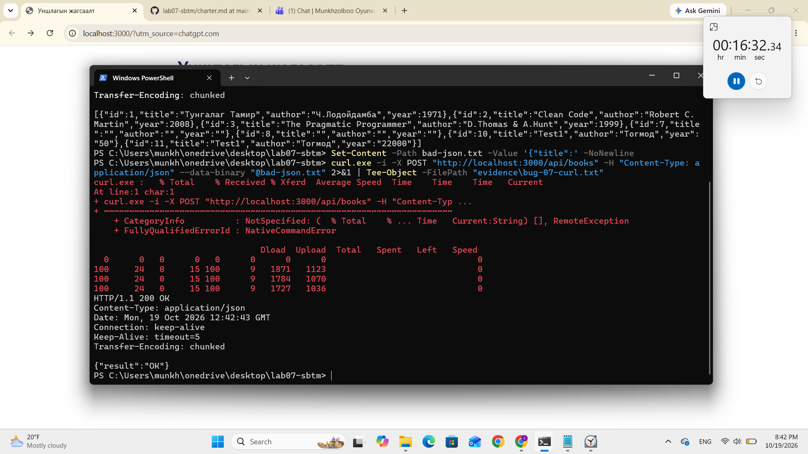

# BUG-07: Буруу форматтай JSON хүсэлтэд HTTP 200 буцааж байна

**Орчин:** Уншлагын жагсаалт v2.0, Windows 11, Node.js v24.19.0, 2026-10-19

**Ноцтой байдал:** Major — API буруу форматтай хүсэлтийг амжилттай гэж хариулж байгаа нь алдааг зөв боловсруулах шаардлагыг зөрчиж байна.

**Олдсон аялал:** Saboteur Tour — API-д зориуд буруу хүсэлт илгээж шалгах.

## Урьдчилсан нөхцөл

`node app.js` командыг ажиллуулж, серверийг шинээр эхлүүлсэн байна.

## Дахин гаргах алхам

1. PowerShell дээр `node app.js` командыг ажиллуулна.
2. Өөр PowerShell цонхонд `bad-json.txt` нэртэй файл үүсгэнэ:

   ```powershell
   Set-Content -Path bad-json.txt -Value '{"title":' -NoNewline
   ```

3. API-д буруу JSON агуулсан POST хүсэлт илгээнэ:

   ```powershell
   curl.exe -sS -i -X POST "http://localhost:3000/api/books" -H "Content-Type: application/json" --data-binary "@bad-json.txt"
   ```

4. HTTP статус код болон серверийн хариуг шалгана.

## Хүлээгдэж байсан үр дүн

Буруу форматтай JSON хүсэлтэд сервер `HTTP 400 Bad Request` буцаах ёстой.

## Бодит үр дүн

Сервер хүсэлтийг амжилттай гэж үзэн дараах хариуг буцаасан:

```text
HTTP/1.1 200 OK
Content-Type: application/json

{"result":"OK"}
```

## Нотлох баримт

Бүрэн HTTP хариуг [evidence/bug-07-curl.txt](../evidence/bug-07-curl.txt) файлаас үзнэ.



## Нэмэлт тэмдэглэл

Сессийн `16:32` хугацаанд илрүүлсэн. Энэ нь хэрэглэгчийн интерфейсээс хамааралгүй, API түвшний согог юм.